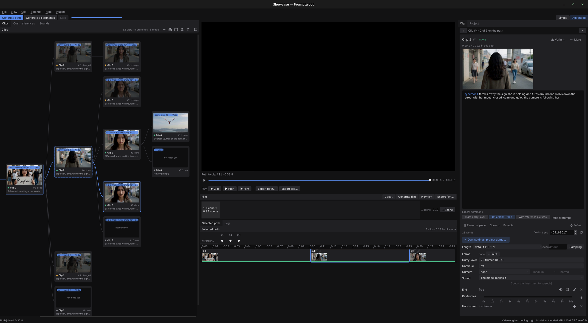

# Promptwood

**Your own Hollywood, from prompts.** Promptwood turns a start image and a few lines of text into a film: every clip
continues from the last frame of the clip before, so the shots join into one story. It is a desktop app and a
command line that drive a local [ComfyUI](https://github.com/comfyanonymous/ComfyUI) with the MiniMax H3 video model,
with everything around the clips that a film needs: a storyboard with branches, a cast with faces and voices, spoken
lines, pictures, music and an upscaled export.

[](LICENSE.md)


-3776ab)


Everything runs on your own computer. Nothing is uploaded unless you choose one of the optional online services
(see [Privacy](#privacy)).

[](docs/images/main-window.png)

<sub>The main window: every clip of the story with its branches (left), the player and the timeline of the
selected path (middle), and the selected clip with its prompt, face and settings (right). Click for full size.</sub>

## Contents

- [Features](#features)
- [How it works](#how-it-works)
- [Requirements](#requirements)
- [Installation](#installation)
  - [Quick start](#quick-start)
  - [What the installer does](#what-the-installer-does)
  - [Choosing what to install](#choosing-what-to-install)
  - [Models you already have](#models-you-already-have)
  - [Updating, checking and removing](#updating-checking-and-removing)
- [Getting started](#getting-started)
- [Command line](#command-line)
- [Configuration](#configuration)
- [FAQ](#faq)
- [Troubleshooting](#troubleshooting)
- [Privacy](#privacy)
- [Responsible use](#responsible-use)
- [Models and their licences](#models-and-their-licences)
- [Project status](#project-status)
- [Development](#development)
- [Contributing](#contributing)
- [Security](#security)
- [Licence](#licence)
- [Acknowledgements](#acknowledgements)

## Features

**Clips and films**
- **Chained clips:** each clip starts from the last frame of the clip before (or from an earlier hand-over frame).
  A *carry-over* of 5, 22 or 39 frames hands over motion and sound, and joins are smoothed (timing and colour of
  the model's copy matched, the last frames blended).
- **Storyboard with branches:** any clip can be continued in several ways; variants with other seeds, freeze what
  works, compare versions side by side. A graph, a timeline and clip cards show the same story.
- **Films with scenes:** several scenes in one film, joined by cut, crossfade or continuation, played and exported as
  one video (the whole film or from one scene to another).
- **Keyframes and end images:** a picture the clip passes through at a given moment, or the frame it must end at.
- **Real videos in the chain:** use a range of your own video, continue from it or lead into it.
- **Camera moves** as short tokens (`#push-in`, `#arc`, `#tilt-up` …), turned into the sentences the model
  understands.
- **Speed modes:** Turbo, HyperFlow and Pika H3 Flex LoRAs, Veda sparse attention, two-pass sampling.
- **Export:** a 2K refine pass, and upscaling with SeedVR2 on your GPU or, optionally, on a RunPod cloud GPU.

**Cast, voices and sound**
- **Cast:** people (face pictures, cropped automatically), places, objects and styles, written as `@Name` in the
  prompts. A place's or object's description can be written from its pictures by the local language model.
- **Character sheets:** from one photo of a person, Qwen-Image 2.1 makes a close-up head sheet and a full-body sheet,
  each the person from the front, in profile and in a three-quarter view (laid out like the templates that come with
  the app). They keep the person the same from every angle in the clips; the head swap takes the head sheet's front
  view. **Sheets…** in the cast (or the question when a person gets a first photo); the prompts can be edited.
- **Spoken lines:** write a line in quotes and the clip speaks it, lips in sync. Voices from
  [Qwen3-TTS](https://huggingface.co/Qwen/Qwen3-TTS-12Hz-1.7B-Base) (clone a voice from a short sample, or design one
  from a description), [Fish S2 Pro](https://huggingface.co/fishaudio/s2-pro) (tones from `[tags]` such as
  `[whispering]`) or ElevenLabs (with your own key).
- **Voice tools:** take a voice from any video or recording, with the background music removed.
- **Libraries for all projects:** voices, whole casts and prompts are kept once and brought into any project.
- **Sound:** audio tracks across clips, a clip's sound laid over or mixed in, the sound of the clip before repeated.

**Pictures**
- **Create images** with Qwen-Image 2.1, Krea-2 Turbo, MOSS-Image, FLUX, Chroma or Illustrious (SDXL), from text or
  from reference pictures.
- **Edit images** with Qwen-Image-Edit 2511, Qwen-Image 2.1 or MOSS-Image: change what you describe, inpaint a
  painted mask, or make an output of another shape (for example a 16:9 character sheet from a portrait).
- **Variations:** placeholders in a prompt make a planned series of images.
- **Random LoRAs:** images from one prompt, each with a random choice of the image model's LoRAs at random strengths
  (pin the ones every image needs, and each image gets them plus at least one random one; leave some out, set a
  range per LoRA and the most per image), a set number or until you press Stop.

**People in existing videos**
- **Head swap** (MiniMax H3 head-swap LoRA or Wan 2.2 Animate) and **face swap** (HyperSwap), with the person's
  pictures from the cast. Please read [Responsible use](#responsible-use).

**Prompts and LoRAs**
- **Prompt refiner:** a local language model (llama.cpp, it can also see the pictures) rewrites a prompt in the
  official MiniMax H3 prompt format, or turns bullet points into several ideas.
- **LoRA manager:** trigger words and example prompts looked up on CivitAI (optional), presets per LoRA, one image per
  LoRA to compare them.
- **Prompt library** with folders and search; examples and a guided first start for new users.

**The app itself**
- A simple and an advanced view, keyboard shortcuts for everything, a setup check under **Help → Setup check**.
- Projects are plain folders. The app never deletes a video, picture or sound of yours: files it no longer uses are
  moved to `old/` in the project.
- Plugins can add features without changing the app.

## How it works

```
start image ─▶ clip 1 ─▶ clip 2 ─▶ clip 3 ─▶ … ─▶ joined film
                  │        │
                  │        └─▶ clip 2b (a branch: another way the story goes on)
                  └─ each clip starts from the last frame of the one before
```

You write what happens in each clip. Promptwood builds the workflow for ComfyUI, with the start frame, the cast's
pictures and voices, the spoken lines and the camera move. It makes the clips one after another and joins the path
you choose into one video. ComfyUI runs the models; Promptwood starts it for you when needed.

## Requirements

| | |
|---|---|
| **System** | Linux, x86-64 (tested on Fedora 44; Ubuntu and Arch should work the same) |
| **Graphics card** | NVIDIA with 24 GB of memory (tested; 16 GB is the least the installer accepts, untested); driver 580 or newer for the CUDA 13 builds (older drivers get the CUDA 12 builds) |
| **Main memory** | 64 GB recommended (large models pass through main memory while they load) |
| **Disk** | 145 GB free for the standard set, 55 GB for video clips only, 270 GB for everything |
| **Internet** | for the installation (about 126 GB of models for the standard set) |

You do **not** need Python, ComfyUI, ffmpeg, git or a compiler beforehand: the installer brings what is missing. The
one thing it cannot install is the NVIDIA driver; it tells you the command for your system.

> [!NOTE]
> **Windows** support is prepared but has not been tested yet: `install.ps1` is the counterpart of `install.sh`, and
> the app has Windows branches for everything that differs there (`src/video_chain/win.py`). macOS is not supported.

## Installation

### Quick start

```bash
git clone https://github.com/mschindler83/promptwood.git
cd promptwood
./install.sh
```

Without git: download **Source code (tar.gz)** of the latest release from
https://github.com/mschindler83/promptwood/releases, unpack it, and run `./install.sh` in that folder.

When it ends with `Promptwood is ready`, every part you installed works. Start it from the applications menu, or with
`promptwood-gui` (if `~/.local/bin` is on your PATH) or `~/.local/share/video-chain/bin/promptwood-gui`.

### What the installer does

1. **Asks first**, before anything big is installed: whether you already have a ComfyUI (its models are then used in
   place), and how much you want, with what each choice still has to download on your computer.
2. **Checks the computer** (graphics card, driver, disk space, ffmpeg) and names anything it cannot fix itself, with
   the command for your system.
3. **Shows the licence** every publisher states for its models, and the app's own terms, and asks whether you accept
   them.
4. **Installs**, in numbered steps with one line each: the app with the package versions it was tested with, ComfyUI
   at the tested revision with PyTorch for your driver, the custom nodes, the model files (resumed after an
   interruption, each checked by SHA-256), text to speech and llama.cpp.
5. **Tests the result with the real models:** it starts ComfyUI, asks it for every node and model the app uses,
   renders a short clip with sound, speaks a test line and asks the language model a question.

Nothing needs root. The installer writes into the app's own folder and its *home* (`~/.local/share/video-chain`, or
`$VIDEO_CHAIN_HOME`), which holds ComfyUI, the models and the tools, plus a menu entry
(`~/.local/share/applications/promptwood.desktop`) and, if `~/.local/bin` is on your PATH, two links there
(`--no-desktop` skips both). Everything the tools print goes to a log in `<home>/logs/`; when a step fails, its last
lines and the log's path are shown.

### Choosing what to install

| Profile | What | Download |
|---|---|---|
| `core` | video clips only | about 40 GB |
| `standard` (recommended) | every part of the app with one model each | about 126 GB |
| `full` | also the extra speed modes, Krea-2, Qwen-Image-Edit 2511, MOSS-Image, Fish S2 Pro voices, both head swaps and the smaller upscaler | about 235 GB |

<details>
<summary>All installer options</summary>

```bash
./install.sh --dry-run                # only show what would be installed and downloaded
./install.sh --profile core           # video clips only
./install.sh --profile full           # everything
./install.sh --with image-krea2       # the standard set plus one part (--help lists all parts)
./install.sh --without tts,llm        # the standard set minus parts
./install.sh --models-from ~/ComfyUI  # a new ComfyUI that reads the models of the one you have, in place
./install.sh --hf-cache ~/.cache/huggingface/hub       # text to speech / language models you already have
./install.sh --comfy-dir ~/ComfyUI    # use the ComfyUI you already have (add --comfy-python if it has no .venv)
./install.sh --yes --accept-licenses  # no questions (for scripts)
VIDEO_CHAIN_HOME=/big/disk/promptwood ./install.sh    # everything on another disk
./install.sh --help                   # all options and all parts with their sizes
```

</details>

[docs/MODELS.md](docs/MODELS.md) lists every part, every file with its size and source, and the licence its
publisher states.

### Models you already have

**Nothing you already have is downloaded again.** Setup looks into ComfyUI's model folders (also the ones from its
`extra_model_paths.yaml` and the ones you name with `--models-from`) and into your Hugging Face cache. Another build of
the same model (bf16 instead of int8, another turbo LoRA, your own GGUF language model with its vision part) counts
as well, exactly as the app itself would accept it. `./install.sh --dry-run` shows what would be downloaded.

A Hugging Face token is optional; with a free read token (https://huggingface.co/settings/tokens) downloads run
smoother: `HF_TOKEN=hf_… ./install.sh`, or log in once with `hf auth login`. Setup sends the token to huggingface.co
only, and never stores or prints it.

### Updating, checking and removing

```bash
git pull && ./install.sh              # update: the app's packages and whatever the new version needs (safe to run again)
promptwood doctor                     # what is installed, what is missing, and the command that fixes it
promptwood doctor --render            # also render a real test clip (--speech, --llm: test those too)
promptwood setup --with headswap-wan  # add a part later
promptwood setup --steps comfyui      # repeat one install step (system, comfyui, nodes)
```

To remove Promptwood, delete its folder and its home (`~/.local/share/video-chain`).

> [!IMPORTANT]
> The home also holds your **libraries of voices, casts and prompts** and your LoRA presets (`voices/`, `casts/`,
> `prompts/`, `lora_presets.json`). Copy them out first if you want to keep them.

Then remove `~/.local/share/applications/promptwood.desktop`, the links `~/.local/bin/promptwood` and
`promptwood-gui`, and, if you want, the settings (`~/.config/video-chain`), the log (`~/.local/state/video-chain`)
and the cache (`~/.cache/video-chain`). API keys stay in your system's keyring until you remove them there. Your
projects are wherever you saved them and are not touched.

## Getting started

1. Start Promptwood (applications menu, or `promptwood-gui`). A short guide on the Clips tab walks you through the
   first clip; **Help → Getting started** shows it again.
2. **Choose a start image** (or make one with **Create a new image…**) and write what happens in the first clip.
3. Click **Generate path**. Promptwood starts ComfyUI, the *video engine*, if it is not running (the setting **Start
   ComfyUI when generating**; the status bar shows "Video engine: …"), and the clip appears on its card when it is
   made.
4. **Continue from here** adds the next clip; **Branch** tries another way the story could go.
5. Add people and places under **Cast** (for a person, best a photo turned into character sheets), give them voices,
   and write spoken lines in quotes:
   `@Anna turns to the window and says "It's starting to rain."`
6. Play the path with **▶ Path**, and export it with **Export path…** when you like it (several scenes: **Generate
   film**, **Play film**, **Export film…**).

## Command line

```bash
promptwood start.jpg prompts.txt --out ~/chains/test1    # one prompt per line, each clip continues the one before
promptwood --help                                        # all options
```

`video-chain` and `video-chain-gui` (the project's earlier name) still work as aliases.

## Configuration

The installer records where things are in `<home>/config.json`; the app's own settings are under
**Settings → Preferences…**. Every location can also be set with an environment variable:

| Variable | What | Default |
|---|---|---|
| `VIDEO_CHAIN_HOME` | the folder the installer fills | `~/.local/share/video-chain` |
| `VIDEO_CHAIN_COMFY_DIR` | ComfyUI's folder | `<home>/ComfyUI` |
| `VIDEO_CHAIN_COMFY_URL` | ComfyUI's address | `http://127.0.0.1:8188` |
| `VIDEO_CHAIN_COMFY_LAUNCHER` | the script that starts ComfyUI | `<home>/bin/comfyui` |
| `VIDEO_CHAIN_HF_CACHE` | the Hugging Face model cache | `<home>/hf-models` |
| `VIDEO_CHAIN_LLAMA_SERVER` | the llama.cpp server program | `<home>/tools/llama.cpp/llama-server` |
| `VIDEO_CHAIN_TTS_PYTHON` | Qwen3-TTS's Python | `<home>/tts-venv/bin/python` |
| `VIDEO_CHAIN_FISH_DIR` | Fish S2 Pro's code and environment | `<home>/fish-speech` |

## FAQ

**Does it work without internet after the installation?** Yes. The models are loaded from your disk; only the
optional services in [Privacy](#privacy) go online.

**How long and how big are the clips?** Each clip is 3 to 15 seconds at 24 frames per second. The size is set per
project, from 384 (a fast draft) to the model's native 768p (1344×768 at 16:9); the export can refine to 2K or
upscale further. A film is as long as its clips together.

**Where are my projects?** In the folder you choose when you make one. A project is a plain folder with its clips,
pictures and sounds; copy it like any other folder.

**Can I use the ComfyUI I already have?** Yes: `./install.sh --comfy-dir ~/ComfyUI`, or keep your ComfyUI and let the
installer reuse its models with `--models-from`.

**Does it work with an AMD or Intel graphics card, or on a Mac?** Not yet: it needs an NVIDIA card (see
[Project status](#project-status)).

**Can I use it commercially?** Not under the free licence; see [Licence](#licence) for a commercial one.

## Troubleshooting

Start with **Help → Setup check** (or `promptwood doctor`): it lists what works, what is missing and the command that
fixes it. The app's log is under **Help → Show the log** (`~/.local/state/video-chain/video-chain.log`).

<details>
<summary><b>"ComfyUI is not reachable"</b></summary>

Click **Start the video engine** in the banner on the Clips tab, or **Start ComfyUI** under **Settings →
Preferences…**, or run `<home>/bin/comfyui`. If you use your own ComfyUI, set its address and start command there too. If another program already uses port 8188, the
installer gives Promptwood's ComfyUI another port (`--comfy-port`), and the app reads it from `config.json`.
</details>

<details>
<summary><b>Out of graphics memory</b></summary>

Close other programs that use the GPU (`nvidia-smi` shows them). Promptwood unloads ComfyUI's models before it starts
text to speech or the language model, and stops those again for the clips. A smaller card may need a speed mode and
a lower resolution. Fish S2 Pro needs a 24 GB card with nothing else on it.
</details>

<details>
<summary><b>ffmpeg is missing, or cannot write H.264</b></summary>

The installer puts a private ffmpeg into `<home>/tools/bin` when the system has none that can write H.264. On Fedora,
the default `ffmpeg-free` cannot: install `ffmpeg` from RPM Fusion, or let the installer bring its own.
</details>

<details>
<summary><b>The NVIDIA driver is too old</b></summary>

The CUDA 13 builds of PyTorch and llama.cpp need driver 580 or newer; with an older driver the installer picks the
CUDA 12 builds. `promptwood doctor` shows the driver it found.
</details>

<details>
<summary><b>Downloads are slow or stop</b></summary>

Run the installer again: downloads continue where they stopped, and finished files are checked, not fetched again.
A Hugging Face token helps against limits on anonymous downloads (see [Models you already have](#models-you-already-have)).
</details>

<details>
<summary><b>A part does not work after an update</b></summary>

Run `promptwood setup`: it installs only what the new version needs and what is missing.
</details>

Still stuck? [Open an issue](https://github.com/mschindler83/promptwood/issues) with the output of
`promptwood doctor` and the end of the log.

## Privacy

Promptwood works offline. Something leaves your computer only when you choose it:

| Service | When | What is sent |
|---|---|---|
| Hugging Face, GitHub, PyPI, astral.sh (uv), download.pytorch.org | installation and updates | download requests (and your Hugging Face token, if you give one) |
| CivitAI | you look up LoRA trigger words (optional, your own key) | the LoRAs' file hashes |
| ElevenLabs | you choose ElevenLabs voices (optional, your own key) | the lines to speak and voice samples you clone there |
| RunPod | you upscale an export on a cloud GPU (optional, your own key) | the clips it upscales |

API keys are kept in your system's keyring (or read from `CIVITAI_API_KEY`, `ELEVENLABS_API_KEY`, `RUNPOD_API_KEY`),
never in project files. RunPod also uses an SSH key the app makes, in `~/.config/video-chain/runpod/`.

## Responsible use

Promptwood can put a real person's face into a video, swap a head, and speak in a cloned voice. Use these only with
people who agreed to it:

- **Consent.** Use a person's face, likeness or voice only with their permission, and only for what they agreed to.
  This includes the pictures you give the cast, the voices you clone or record, and every face or head swap.
- **No harm.** Do not make content that impersonates, deceives, harasses, defames or sexualises a real person, that
  shows a minor in any sexual or harmful way, or that is meant to mislead people about real events (fake news,
  fraud, political deception).
- **Say that it is made with AI.** Label generated or altered videos, pictures and voices of real people as such when
  you publish them. Several laws require it (for example the EU AI Act for "deepfakes"), and so do many platforms.
- **Rights in what you put in.** Use pictures, videos, music and voices you are allowed to use (your own, licensed, or
  with permission).
- **The models' own rules.** Each model comes with its publisher's licence and use policy (see
  [docs/MODELS.md](docs/MODELS.md)); several forbid exactly the uses above, and some allow no commercial use at all.

You are responsible for what you make with Promptwood and for following the law where you live and publish. The
software comes without any warranty (see the licence).

## Models and their licences

Promptwood installs programs and models made by others, and each keeps its own licence.

> [!WARNING]
> **Many of the models are not free for every use.** The MiniMax H3 video models come under MiniMax's community
> licence, Qwen-Image 2.1 under a research licence, the InsightFace face models are for non-commercial research only,
> Fish S2 Pro (part `tts-fish`, not in the standard set) under the Fish Audio Research License (research and
> non-commercial use only), and for some files (the HyperSwap and GPEN face models) the publisher states no licence at
> all.

The installer shows, per part, what each publisher states and asks before it downloads;
[docs/MODELS.md](docs/MODELS.md) has the full list with links. Whether your use is allowed is yours to check; parts
you do not want can be left out (`--without faces`).

## Project status

Promptwood is young and changes quickly (version 0.2.0).

- **Tested:** Linux (Fedora 44) with an NVIDIA card with 24 GB, through ComfyUI at the revision the installer pins.
- **Prepared, not tested yet:** Windows (`install.ps1`).
- **Not supported:** macOS, AMD and Intel graphics cards.

## Development

```bash
uv sync --extra faces --extra dev
QT_QPA_PLATFORM=offscreen .venv/bin/python -m pytest      # no models, no GPU, no network (about 2 minutes)
.venv/bin/python -m pytest -m models                       # with real models in a running ComfyUI
python tools/build_manifest.py                             # after changing the list of downloads
```

| Folder | What |
|---|---|
| `src/video_chain/` | the app (the package keeps its earlier name): `tree/` the project model, `comfy/` the workflows, `ui/` the windows |
| `src/video_chain/setup/` | the installer and the doctor (standard library only), `manifest.json` the list of downloads |
| `comfy_nodes/video_chain_nodes/` | Promptwood's own ComfyUI nodes (GPL 3.0) |
| `tests/` | the test suite (pytest, Qt offscreen) |

## Contributing

Bug reports and ideas are welcome as [issues](https://github.com/mschindler83/promptwood/issues). A good bug report
has the output of `promptwood doctor`, the end of the log (**Help → Show the log**), what you did and what happened.

Code contributions are welcome after a short contributor agreement that lets the author also offer them under the
commercial licence (see [Licence](#licence)). Please open an issue before you start on one; the agreement is sent
there. Pull requests without it cannot be merged.

## Security

Please report security problems privately through
[GitHub's security advisories](https://github.com/mschindler83/promptwood/security/advisories/new), not in a public
issue.

## Licence

Promptwood is free for **non-commercial use** under the [PolyForm Noncommercial License 1.0.0](LICENSE.md): personal
projects, hobby, study and research, and non-profit, educational and public organisations may use, change and share
it. Its source is public (source-available), but this is not an OSI open-source licence: **commercial use** (in a
business, for clients, for monetised content) needs a separate licence from the author. Ask through
[an issue](https://github.com/mschindler83/promptwood/issues) titled "Commercial licence".

The ComfyUI nodes in `comfy_nodes/video_chain_nodes/` run inside ComfyUI and use its code, so they are licensed under
the [GNU GPL 3.0](comfy_nodes/video_chain_nodes/LICENSE), as ComfyUI is.

A licence for Promptwood covers Promptwood only, never the models it uses: those keep their publishers' licences
(see [Models and their licences](#models-and-their-licences)), whatever your licence for the app.

## Acknowledgements

Promptwood stands on the work of many others: [ComfyUI](https://github.com/comfyanonymous/ComfyUI), MiniMax's H3 video
models, Qwen's image, text-to-speech and vision-language models, [Fish Audio](https://github.com/fishaudio/fish-speech),
[llama.cpp](https://github.com/ggml-org/llama.cpp), SeedVR2, Krea, MOSS-Image, InsightFace, FaceFusion's HyperSwap
models and method, the authors of the speed-mode LoRAs and ComfyUI nodes listed in [docs/MODELS.md](docs/MODELS.md),
and [PySide6](https://doc.qt.io/qtforpython-6/). Thank you.

Promptwood is an independent project. It is not affiliated with or endorsed by any of the model publishers, ComfyUI,
or the film industry of Hollywood.
